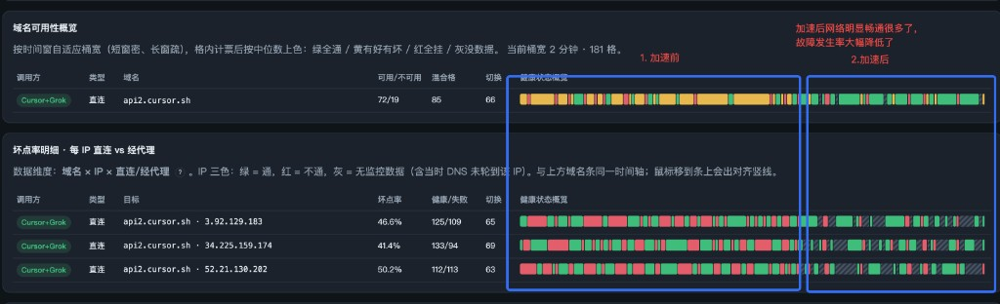

# Cursor 网络加速器

> 英文仓库名：`cursor-net-accelerator`  
> 配套观测项目：[Cursor 网络监控](https://github.com/lixiyu/cursor-api2-monitor)（`cursor-api2-monitor`）

## 这是干什么的

Cursor 突然发不出消息、一直转圈、失败了又重试——常见原因之一是：对话入口域名解析出多个 IP，其中混着当前连不上或极慢的地址，而客户端又没有做好多地址优选，于是先撞上坏点干等。

其实业界早就有一套成熟做法，叫 **Happy Eyeballs**：当域名解析出多个 IP 时，客户端会短间隔去试这些地址，尽快找出当前能连通、建连更快的那个，再把后续请求发过去，避免卡在一条坏地址上干等。

这条思路大约在 **2011** 年前后成形（IETF 草案里开始叫 Happy Eyeballs），**Google Chrome** 约在 **2011 年 5 月**（Chrome 11）就已落地；**2012 年 4 月** 正式写成 [RFC 6555](https://www.rfc-editor.org/rfc/rfc6555)，**2017 年** 又有加强版 [RFC 8305](https://www.rfc-editor.org/rfc/rfc8305)。**Node.js** 则晚一些：[`autoSelectFamily`](https://nodejs.org/docs/latest/api/net.html#socketconnectoptions-connectlistener) 于 **2022 年 12 月 14 日**随 Node.js **19.3.0** 进入 `net.connect`，**2023 年 1 月 5 日**回落到 LTS **18.13.0**，到 **2023 年 4 月 17 日**的 Node.js **20.0.0** 起默认开启。

Cursor 的对话 / 推理相关能力同样跑在 Node.js 上，但他们在 Agent 对话的传输路径上加了**远程门控**：可以在后台远程关掉部分用户本机客户端的 `autoSelectFamily`，禁用 Happy Eyeballs，改成**单地址拨号**。关掉之后，客户端往往不再在多个 IP 间竞速，而是粘在某一个地址上（例如近期会话用过的那条）。一旦这条地址不能持续稳定连通，任务就会频繁中断、发送失败。

本仓库要做的，是在本机把类似效果补回来：对 Cursor 任务相关 API 域名做 **TCP/TLS 建连探测**，筛出当前可达的入口 IP，再通过本机 DNS 把这些可用地址返回给客户端。

- 只做建连探测，并通过本机 DNS 返回当前可用入口 IP  
- 本期只做 macOS 本机优化（探测 + 本地 DNS + 本机状态页）  
- 只覆盖配置里的 Cursor 相关域名  

> 小趣闻：Happy Eyeballs 最初主要是为了 IPv4 / IPv6 双栈少踩坑；Chrome、Node 落地的是同一类思路——多地址快试，用通的那条。Cursor 关掉的是 Node 的 `autoSelectFamily`，效果上就是不做这种多地址优选。

## 效果一眼看懂

下面来自配套监控（[Cursor 网络监控](https://github.com/lixiyu/cursor-api2-monitor)）同一段时间的对照：开启本加速器之后，域名整体可用性从「黄红搅在一起」变成大段畅通；底下各 IP 直连仍有红绿交错，说明节点本身并不完美——加速器做的是**剔坏、选用通的入口**，而不是把每个 IP 都修通。



## 原理

1. **探测**：经上游公共 DNS 解析白名单域名（避免问到自己的本地 DNS 绕圈），对每个 IP 测 `TCP :443`（可选极短 TLS+SNI）
2. **可用池**：通的留下并按延迟排序；不通的短期隔离
3. **本地 DNS**：只对白名单域名返回当前可用 A 记录；配合 macOS `/etc/resolver` 把该域指到本机
4. **可观测**：本机状态页按**对端 IP**汇总——探测结果、DNS 下发、Cursor 进程实际连上的 IP，并对照 Cursor 本地日志里的传输失败（日志本身不含对端 IP，需按时间对照）

## 安装（macOS）

需要：macOS、Python 3.10+、能访问上游公共 DNS（默认 Cloudflare / Google）。

```bash
git clone <本仓库地址>
cd cursor-net-accelerator
python3 -m venv .venv
source .venv/bin/activate
pip install -e .
```

装好后终端里应能直接跑：`cursor-net-accelerator --help`。

## 最短上手（按这个顺序）

开两个终端窗口：

**窗口 A — 一直跑着加速器**

```bash
source .venv/bin/activate
cursor-net-accelerator run
```

看到日志里有 DNS / 状态页地址后，浏览器打开：<http://127.0.0.1:8789/>  
先确认「可用池」里至少有健康 IP。

**窗口 B — 把 Cursor 域名指到本机 DNS（只需做一次，直到你 `disable-dns`）**

```bash
source .venv/bin/activate
cursor-net-accelerator enable-dns   # 会要管理员密码
cursor-net-accelerator status       # resolver 应为「已安装」
```

然后清一下系统 DNS 缓存，再验证解析：

```bash
sudo dscacheutil -flushcache
sudo killall -HUP mDNSResponder

dscacheutil -q host -a name api2.cursor.sh
# 或（问系统解析，应落到本机 53553 筛过的地址）
dig api2.cursor.sh +short

# 对比：直接问上游，仍可能看到多个含坏点的 IP
dig @1.1.1.1 api2.cursor.sh +short
```

到这里 Cursor 才会真正用上我们挑好的 IP。状态页里也可看「最近事件」里的 `dns` 下发是否在增加。

**不用时务必先拆指路条，再停服务**，否则 `*.cursor.sh` 还指着本机空端口：

```bash
cursor-net-accelerator disable-dns
# 再回到窗口 A：Ctrl+C 停掉 run
```

## 常用命令

```bash
cursor-net-accelerator probe          # 只探测一轮，看当前可用 IP
cursor-net-accelerator run            # 探测循环 + 本地 DNS + 状态页
cursor-net-accelerator status         # 配置与 /etc/resolver 是否已装
cursor-net-accelerator enable-dns     # 写入分域 DNS（需管理员权限）
cursor-net-accelerator disable-dns    # 移除分域 DNS
```

## 关键：为什么一定要配 `/etc/resolver/cursor.sh`

很多人以为「`run` 起来了就行」。对这个加速器来说，**不够**。

可以把它想成两件事：

1. **本软件**（`run`）在电脑里开了一个「小问询台」：只负责回答 Cursor 相关域名「现在该连哪个 IP」，并把坏的剔掉。默认听在 `127.0.0.1:53553`。  
2. **macOS 默认不会来问这个台子**。Cursor 查 `api2.cursor.sh` 时，系统仍会去问平时的 DNS，照样可能抽到坏 IP——加速器等于白开。

`/etc/resolver/cursor.sh` 就是 macOS 自带的一张**分域指路条**（系统机制，不是我们发明的黑科技）：

- 文件名里的 `cursor.sh` 表示：凡是 `*.cursor.sh` 这类域名  
- 文件内容写明：去问本机的加速器 DNS（默认 `127.0.0.1`，端口 `53553`）  
- 其它网站不受影响，还是走系统原来的 DNS  

没有这张纸条 → Cursor 不走我们的选路。  
有了这张纸条 + `run` 在跑 → Cursor 解析到的才会是我们筛过的可用 IP。

`enable-dns` 实际会创建类似这样的文件（可用 `cat /etc/resolver/cursor.sh` 查看）：

```text
# managed by cursor-net-accelerator — do not edit by hand
nameserver 127.0.0.1
port 53553
```

若改过 `CURSOR_NET_ACCEL_DNS_PORT` / `CURSOR_NET_ACCEL_RESOLVER_DOMAIN`，请先改环境变量再执行 `enable-dns`（会按当前配置重写指路条）。

### 常见踩坑

| 现象 | 常见原因 |
|------|----------|
| 加速器在跑，Cursor 仍经常失败 | 没 `enable-dns`，或装完没 `flushcache` |
| `enable-dns` 之后全挂 | `run` 没在跑，或本机 `53553` 被占用 |
| `dig` 看到一堆 IP，状态页健康却很少 | 你问的是上游；请对比 `dig @1.1.1.1` 与系统解析 / 状态页 DNS 下发 |
| 不用了却解析异常 | 停 `run` 前没 `disable-dns` |

## 状态页怎么用

地址默认：<http://127.0.0.1:8789/>

- **选路模式**  
  - **开启加速**：DNS 只返回当前探测健康的 IP（没有健康 IP 时会降级为返回全部解析结果）  
  - **关闭加速**：原样返回上游解析，不筛选  
  - **拉闸测试**：故意只返回坏 IP；若 Cursor 因此用不了，说明本机 DNS 指路已生效。测完请切回「开启加速」  
- **健康状态概览**：「服务可达性」看上游全部 IP；「加速效果」按**当时选路挑中的 IP**上色（与模式天然一致）  
- 探测史默认保留近 6 小时，并落在本机  
  `~/Library/Application Support/cursor-net-accelerator/data/health-history.json`  
  （超时自动清理；重启可恢复近窗数据）

## 环境变量（配置）

在运行 `run` / `enable-dns` 的同一个 shell 里 `export` 即可，例如：

```bash
export CURSOR_NET_ACCEL_HOSTS=api2.cursor.sh
export CURSOR_NET_ACCEL_INTERVAL=30
cursor-net-accelerator run
```

| 变量                                         | 默认                    | 含义                              |
| ------------------------------------------ | --------------------- | ------------------------------- |
| `CURSOR_NET_ACCEL_HOSTS`                   | `api2.cursor.sh`      | 逗号分隔白名单域名                       |
| `CURSOR_NET_ACCEL_INTERVAL`                | `30`                  | 探测间隔（秒）                         |
| `CURSOR_NET_ACCEL_TIMEOUT`                 | `3`                   | 单 IP 探测超时（秒）                    |
| `CURSOR_NET_ACCEL_QUARANTINE`              | `120`                 | 坏 IP 隔离秒数                       |
| `CURSOR_NET_ACCEL_POOL_TTL`                | `90`                  | 健康结果最长沿用秒数                      |
| `CURSOR_NET_ACCEL_UPSTREAM_DNS`            | `1.1.1.1,8.8.8.8`     | 探测用上游 DNS（不经本机加速器）              |
| `CURSOR_NET_ACCEL_DNS_BIND` / `…_DNS_PORT` | `127.0.0.1` / `53553` | 本地 DNS                          |
| `CURSOR_NET_ACCEL_RESOLVER_DOMAIN`         | `cursor.sh`           | 写入 `/etc/resolver/<domain>` 的域名 |
| `CURSOR_NET_ACCEL_WEB_BIND` / `…_WEB_PORT` | `127.0.0.1` / `8789`  | 状态页                             |
| `CURSOR_NET_ACCEL_PEER_INTERVAL`           | `10`                  | 采样 Cursor 对端连接间隔（秒）             |
| `CURSOR_NET_ACCEL_FAIL_INTERVAL`           | `60`                  | 扫描 Cursor 失败日志间隔（秒）             |
| `CURSOR_NET_ACCEL_HEALTH_RETENTION_HOURS`  | `6`                   | 健康条保留时长（小时）；超时清理，并落盘可跨重启        |
| `CURSOR_NET_ACCEL_STATE_DIR`               | 见右                    | 状态目录；默认 `~/Library/Application Support/cursor-net-accelerator` |
| `CURSOR_NET_ACCEL_CURSOR_LOGS`             | Cursor 默认日志目录         | 可选：指定 Cursor Agent Host 日志根目录   |

## 非目标

- 不解密 TLS、不读取对话内容
- 不做成面向任意网站的通用工具
- 本仓不包含计费、账号、远程节点

## License

MIT
