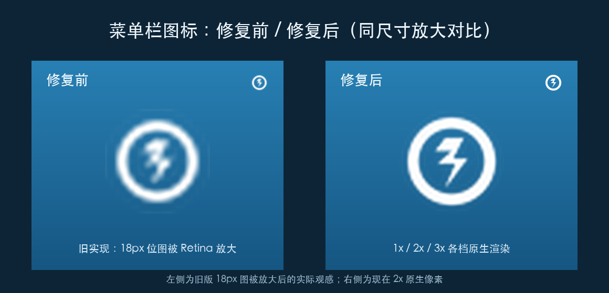

# macOS 图标制作笔记

本项目有两套图标：Finder/Dock 用的 **App 主图**，和屏幕右上角菜单栏里的 **template 小图标**。两者尺寸、画法、加载方式都不同。这份笔记记录可复用的规格、关键坑和验证方法。



> 一句话：菜单栏图标不是把主图缩小，而是按 18pt 重新画一份单色轮廓，输出 1x/2x/3x 三档，并让 `NSImage` 同时持有三个 rep。

## 0. 先分清两种图标

| | App 主图 | 菜单栏图标 |
|---|---|---|
| 用在哪 | Finder / Dock / 启动器 | 屏幕右上角状态栏 |
| 画布 | 1024×1024 PNG | 18×18 pt |
| 像素档位 | 16 / 32 / 64 / 128 / 256 / 512 / 1024 | 18 / 36 / 54 px |
| 颜色 | 彩色，teal 渐变 | 单色，只有 alpha |
| 系统处理 | 原样显示 | 按菜单栏外观着色，禁用态自动变淡 |
| 生成方式 | CoreGraphics 矢量母版 → iconset → icns | 18pt 网格上画 → 8x 超采样 → 三档 PNG |

动手前先确认要的是哪一个。把主图缩到 18pt 当菜单栏图标，渐变、细线和内部细节都会消失。

## 1. App 主图规格

当前主图（已定稿并生成 `AppIcon.icns`，日常不需要重跑）：

- 1024×1024，RGBA，透明背景
- 圆角矩形主体铺满约 88%，四周留 6% 左右
- 青绿纵向渐变 `#14968A → #0A645E`
- 正中白色空心圆环 + 白色闪电，扁平、居中
- 线宽约为图标宽度的 4.6%，闪电约为圆环内径的 70%

标准的 iconset 文件名为：

| 文件名 | 像素 |
|---|---|
| `icon_16x16.png` | 16 |
| `icon_16x16@2x.png` | 32 |
| `icon_32x32.png` | 32 |
| `icon_32x32@2x.png` | 64 |
| `icon_128x128.png` | 128 |
| `icon_128x128@2x.png` | 256 |
| `icon_256x256.png` | 256 |
| `icon_256x256@2x.png` | 512 |
| `icon_512x512.png` | 512 |
| `icon_512x512@2x.png` | 1024 |

标准 iconset 的命名规则如上，`iconutil` 按名字识别倍率；目录里混入其他文件名会报错或漏档。主图母版来自 `gen-app-icon.swift`，当前 `AppIcon.icns` 已生成并定稿。

## 2. 菜单栏图标规格

本项目按 18pt 画布设计：

- 画布 18×18 pt；输出 18 / 36 / 54 px 三档
- 外圈直径 15pt，线宽 1.9pt，闪电约 8.4×5.4pt，四周留约 1.5pt
- 黑色图形 + alpha，最终 `isTemplate = true`
- 小尺寸优先保证轮廓：线宽不低于 1.8pt，内部转折能简化就简化
- 在 18pt 网格上直接画，不拿主图缩放

菜单栏高度约 22–24pt，18pt 图标上下各留一点余量，和系统图标放一起不会顶满。

模板图只使用 alpha 通道，颜色由系统决定：浅色菜单栏显示黑色，深色菜单栏显示白色，窗口失焦或 `appearsDisabled` 时整体变淡。所以源图不需要也不能靠颜色区分状态。

## 3. 关键坑：Retina 只认 `NSImage` 里的 rep

错误写法：

```swift
let img = NSImage(contentsOf: url)   // 只读了一个 18×18 的 rep
img.size = NSSize(width: 18, height: 18)
```

`NSImage(contentsOf:)` 读单个 PNG 时只得到那一个 rep；`MenuBarIcon@2x.png` 即使和 1x 放在同一目录，也不会被自动发现。到了 2x 屏，菜单栏需要 36px 图像，AppKit 只能把 18px 放大——结果就是糊边和锯齿。

正确写法：把三档装进同一个 `NSImage`，每个 rep 的 `size` 都标成 18pt：

```swift
let dir = Bundle.main.resourceURL!
let image = NSImage(size: NSSize(width: 18, height: 18))
for name in ["MenuBarIcon", "MenuBarIcon@2x", "MenuBarIcon@3x"] {
    guard let data = try? Data(contentsOf: dir.appendingPathComponent("\(name).png")),
          let rep = NSBitmapImageRep(data: data) else { continue }
    rep.size = NSSize(width: 18, height: 18)   // 18/36/54 px 都对应 18pt
    image.addRepresentation(rep)
}
image.isTemplate = true
```

`rep.size` 是点，`rep.pixelsWide` 是像素，两者比值就是这一档的倍率。AppKit 按目标屏幕选最接近的一档；2x 屏直接用 36px，不再放大。

快速验证：

```swift
print(image.representations.map { "\($0.pixelsWide)x\($0.pixelsHigh) size=\($0.size)" })
// 期望：18x18 size=(18.0, 18.0) / 36x36 ... / 54x54 ...
```

再把 `image` 画进 36px 的 bitmap，输出应与 `MenuBarIcon@2x.png` 逐像素一致。若不一致，说明 AppKit 仍在放大 1x。

其他可选路径：

- Asset Catalog + `actool`：`NSImage(named:)` 自动处理 @2x，代价是多一步资源编译
- `NSImage(size:flipped:drawingHandler:)`：矢量绘制，分辨率无关；同样要设 `isTemplate`

本项目选了显式加载三档，打包脚本直接拷贝 PNG，不依赖 Xcode 工程。

## 4. 抗锯齿：高倍超采样再缩

- 在 `18 × supersample`（本项目 8）的画布上画矢量图形
- 缩到目标尺寸用 LANCZOS；每一档都从超采样画布缩，不从 18px 再放大
- 输出 RGBA PNG，alpha 保留抗锯齿过渡，不要转成二值 alpha 或索引色
- 斜线、圆弧落在半像素上没关系，关键是源分辨率足够

`render_menubar(size, supersample=8)` 的实际流程：先在 144 / 288 / 432 px 画外圈和闪电，再分别缩到 18 / 36 / 54。

## 5. 打包与加载

- 三档 PNG 都要进 `Contents/Resources`；`pack-app.sh` 里逐个拷贝 `MenuBarIcon.png`、`@2x`、`@3x`
- 加载优先 `Bundle.main.resourceURL`；`swift run` 开发态沿可执行文件向上找源码目录的 `Resources/`
- 读不到时回退 `NSImage(systemSymbolName: "bolt.fill")`，保证菜单栏不会空白
- `isTemplate = true` 要设在最终交给 `statusItem.button.image` 的 `NSImage` 上

## 6. 验证清单

- [ ] `file` 确认三档尺寸为 18 / 36 / 54，模式为 RGBA
- [ ] `image.representations` 三档都在，`size` 都是 18pt
- [ ] 2x 上下文渲染结果与 `MenuBarIcon@2x.png` 逐像素一致
- [ ] 实机截图：浅色/深色菜单栏、运行/禁用态都能看清
- [ ] 和相邻图标（Docker、输入法等）放一起，视觉重量不突兀
- [ ] 只改菜单栏时，`AppIcon.icns` 哈希保持不变

实机验证不必启动加速服务：写个临时 `NSStatusItem` 预览程序，挂同一张模板图，`screencapture -x` 截图，再和相邻图标对比即可。

## 7. 症状排查

| 症状 | 常见原因 | 处理 |
|---|---|---|
| 糊、边缘发虚 | 只加载了 1x，Retina 放大 | 三档 rep 装进同一个 `NSImage` |
| 圆环断成一格一格 | 18px 上画了过细的线或复杂形状 | 加粗到 1.8pt 以上、简化轮廓、8x 超采样 |
| 菜单栏完全不显示 | 没有 alpha / 没设 template / 没进 bundle | 逐项检查资源和 `isTemplate` |
| 显示成彩色或黑块 | 没设 `isTemplate` | `image.isTemplate = true` |
| 3x 屏仍模糊 | 缺 `@3x` | 补 54px 档 |
| 比邻居大一圈 | 主体超出 15pt 或画布不是 18pt | 回到 18pt 网格重画 |

## 8. 重新生成菜单栏图标

依赖 Python 3 + Pillow；只跑菜单栏图标不需要 `swift`。

```bash
cd apps/macos-menubar
python3 scripts/gen-icons.py --menubar-only
```

产物：

- `Resources/MenuBarIcon.png`（18px）
- `Resources/MenuBarIcon@2x.png`（36px）
- `Resources/MenuBarIcon@3x.png`（54px）

`--menubar-only` 只写这三张图，不会重建 `AppIcon.icns` / `AppIconPreview.png`，主图保持原样。

打包与安装：

```bash
./scripts/pack-app.sh
# 先退出正在运行的 App，再覆盖安装
CURSOR_NET_ACCEL_INSTALL=1 ./scripts/pack-app.sh
open "/Applications/Cursor 网络加速器.app"
```

## 9. 相关文件

- [gen-icons.py](../../apps/macos-menubar/scripts/gen-icons.py)
- [gen-app-icon.swift](../../apps/macos-menubar/scripts/gen-app-icon.swift)
- [AppDelegate.swift](../../apps/macos-menubar/Sources/CursorNetAccelMenu/AppDelegate.swift)
- [pack-app.sh](../../apps/macos-menubar/scripts/pack-app.sh)
